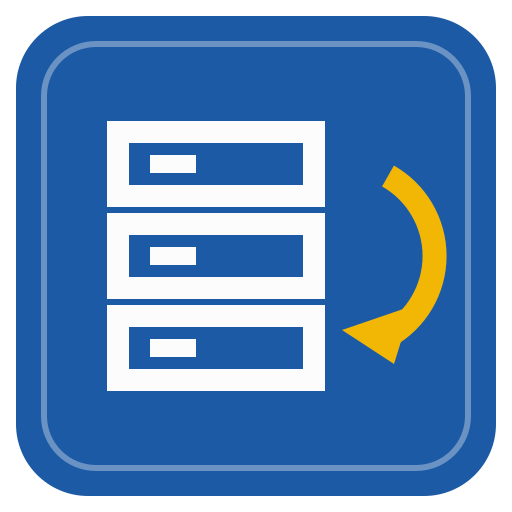

# Repo Sync



A desktop app (Windows first, Linux kept portable) that keeps an offline library of software projects and their releases.

- **Add a project by its link.** Paste one link or many: GitHub, GitLab (including groups and self-hosted servers), Codeberg and other Gitea or Forgejo servers. An unknown server is asked whether it's Gitea or GitLab.
- **Add everything an account owns.** Paste a link to a GitHub user or organisation (or a GitLab group, a Codeberg user) and all of their projects are added; the account is followed, so its new projects are added at each check.
- **The code and the latest release are downloaded.** The default branch (or one you choose) is captured as plain files, and the latest release's files beside it: every file, only the ones for this computer's system, or only the notes. The Releases tab lists every release on the server, with a box to keep any of them.
- **Updates on a schedule, nothing thrown away.** Every project is checked every day (or hour, week, by hand: for the library or per project). A new commit becomes a new folder under `source/`, a new release a new folder under `releases/`. Earlier versions stay until you delete one yourself.
- **An information page for each project.** Its readme (formatted, with its pictures shown from the captured files, offline), size on disk, when it was added, last captured, last checked and last updated upstream, the latest commit and release, licence, language, stars, topics, and every kept version and release with their notes.
- **Launch the latest release.** The best program for this computer is found in the release (a portable ZIP is unpacked beside itself first); the Launch menu lists the others and remembers your choice.
- **Sorted and searched offline.** Search names, descriptions, topics, your own tags and the text of every readme. Filter by tag, language or server; sort by update, capture, size or stars.

The design and the plan are in [docs/PLAN.md](docs/PLAN.md). The stack and look follow [Model Library](https://github.com/DrFlGd/Model-Library), [SCAD Workshop](https://github.com/DrFlGd/SCAD-Workshop) and [Game Repo](https://github.com/DrFlGd/Game-Repo): a Rust core, a Tauri 2 window, a Preact page with no build step, the Drafting Sheet skin.

## The library folder

```
Repo Sync/                         (~/Repo Sync until you choose another folder)
  _library/library.json            the library's id, name and settings (schedule, defaults, size limit)
  _library/accounts.json           the accounts followed for new projects
  github.com/owner/name/
    repo.json                      details, what it follows, tags, every captured version and release
    source/2026-10-29_0325_1a2b3c4/   one folder per captured commit (date captured, commit)
    releases/v1.2.0/               one folder per captured release: its files and RELEASE_NOTES.md
  gitlab.com/group/sub/name/ …
```

Everything the app shows comes from these files, so the folder can be moved, synced or opened on another computer. Tokens for the servers stay on this computer, never in the library.

## Status

First version (0.1). Installers are on the [releases page](https://github.com/DrFlGd/Repo-Sync/releases) once CI publishes one (Windows: the `-setup.exe`, unsigned, so SmartScreen asks once).

Checks run while the app is open. To check while it's closed, schedule `reposync-cli check-all` (Windows Task Scheduler, cron); it uses the same library.

## Building

- `desktop/core`: the Rust core (`reposync-core`, and `reposync-cli`). `cargo test -p reposync-core` in `desktop/`.
- `web/`: the interface (Preact + htm, no build step).
- The app: `python3 tools/build_desktop.py --out build/desktop`, then `npx @tauri-apps/cli@2 build` in `desktop/`.
- The acceptance test (the page against the real backend and a stand-in for GitHub and GitLab, in Chromium): `python3 tests/desktop_page.py --cli desktop/target/debug/reposync-cli --ui build/desktop/ui --home /tmp/rs-home --out /tmp/rs-shots` (needs `pip install playwright` and git).

CI (`.github/workflows/desktop.yml`) builds and tests the Windows app on every push and pull request and publishes a numbered release from `main`. `CHANGELOG.md` has the map of the code for whoever works on it next.

## Licence

Not chosen yet. Third-party code and fonts are listed in [THIRD_PARTY.md](THIRD_PARTY.md).
